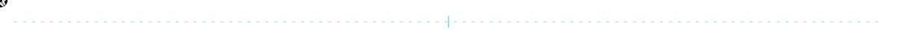
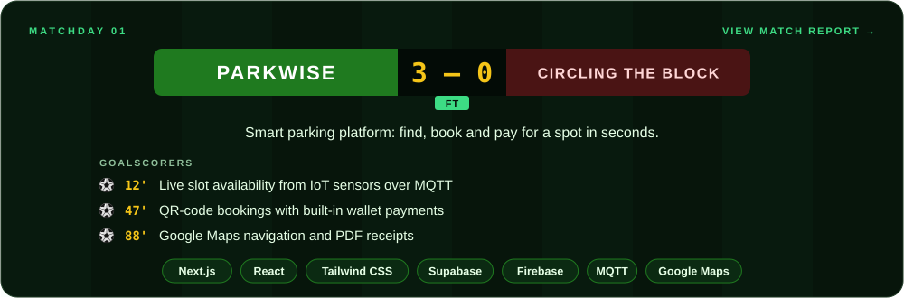
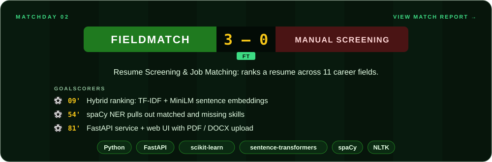
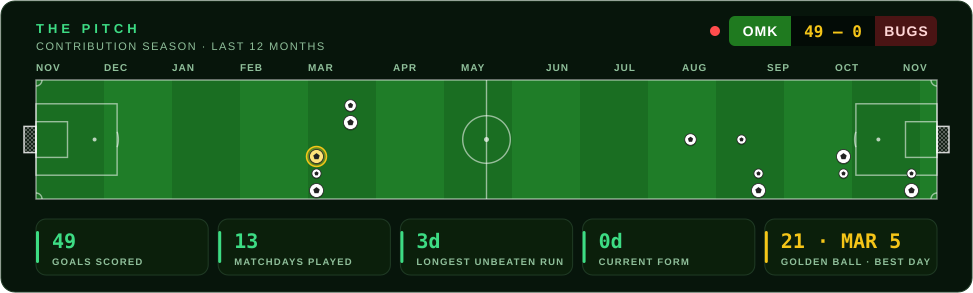
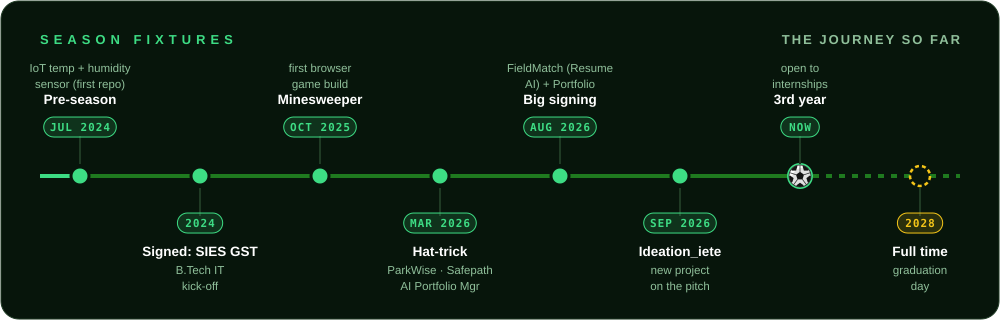
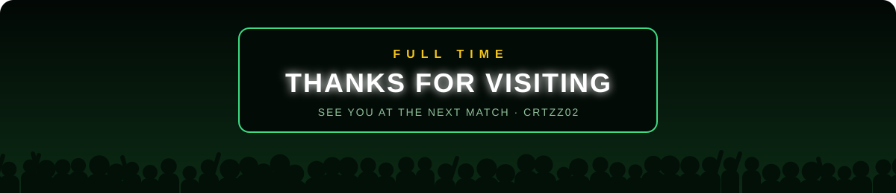

 

## 📋 Team Sheet

## 🧠 Formation · Tech Stack

## 🏆 Featured Matches

🪑 <b>Reserves:</b> <a href="https://github.com/Crtzz02/Safepath">Safepath</a> · <a href="https://github.com/Crtzz02/ai-portfolio-manager-">AI Portfolio Manager</a> · <a href="https://github.com/Crtzz02/personal-portfolio">Personal Portfolio</a> · <a href="https://github.com/Crtzz02/minesweeper">Minesweeper</a>

## 🏟️ The Pitch · Contribution Season

Every ball on the pitch is a day I shipped code: the bigger the ball, the bigger the day. The golden ball marks my best day of the season.

## 📅 Season Fixtures

### 📬 Contact the Gaffer

*"I learned all about life with a ball at my feet."* — Ronaldinho ⚽

